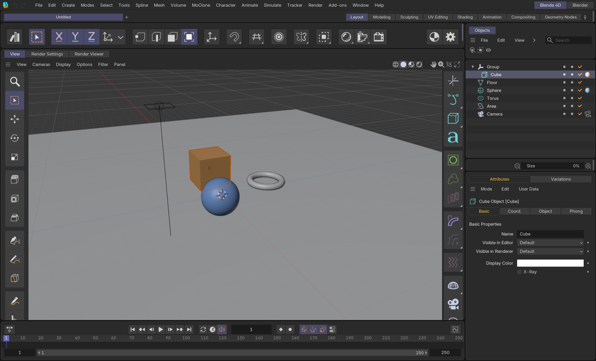

# Blenda 4D

**English** | [简体中文](README.zh-CN.md)

> **This is a community fork** of [recon007jf/Blenda4D](https://github.com/recon007jf/Blenda4D) with a bug-fix
> release (**0.1.27**) and a **one-click installer for Windows + macOS**. Everything else is the original project,
> same GPL-3.0 licence. See [What's new in this fork](#whats-new-in-this-fork-0127).

A free, open-source add-on that gives Blender a motion-design layout and workflow.



Blenda 4D replaces Blender's editor layout with its own: a command bar, tool columns, an **Object Manager**, an
**Attribute Manager** that always shows what is selected, a **Material Manager**, an **Asset Browser**, a timeline
and saved layouts. Everything is drawn with Blender's own buttons, fields and menus, and one switch at the top right,
**Blenda 4D | Blender**, takes you back to standard Blender and returns.

It is a plain Python add-on: no patched Blender, nothing to compile. It runs wherever Blender 5.2 LTS or later runs
(Mac, Windows, Linux).

## What's new in this fork (0.1.27)

- **Fix: Render Settings now restore viewport shading.** Switching between named render settings silently skipped
  every `display.shading.*` value (viewport light, color type, backface culling, x-ray, shadows, cavity, outline,
  specular highlight), so the viewport never went back to how a setting had it. One-line parsing fix in
  `render_settings.py`, verified by the project's own headless test (was `FAIL 1`, now `ALL PASS`).
- **One-click installer for Windows + macOS** (`Blenda4D-0.1.27-OneClick-WinMac.zip` on the
  [Releases page](https://github.com/luoboruodai/Blenda4D/releases)): finds every Blender 5.2+ on the machine,
  installs and enables Blenda 4D through Blender's own extension installer, and reports per-version results.
  Uninstallers included. No manual steps, nothing written outside Blender's user folders.
- **Test-harness fixes** so the project's own checks run to completion on Blender 5.3 (`tools/tests/`).

Verified on macOS with Blender 5.2.2 LTS and 5.3.0 Alpha: full install → uninstall → reinstall cycle, the project's
12 headless test suites, and a real-UI smoke test (layout on/off restore). The Windows installer scripts are
statically checked but not yet run on a real Windows machine - reports welcome.

## Install

### The easy way: one-click installer (Windows + macOS)

1. Install [Blender 5.2 LTS](https://www.blender.org/download/) or later.
2. Download **`Blenda4D-0.1.27-OneClick-WinMac.zip`** from the
   [latest release](https://github.com/luoboruodai/Blenda4D/releases/latest) and unzip it.
3. Double-click **`Install Blenda4D (Mac).command`** on macOS (first time: right-click → Open), or
   **`Install Blenda4D (Windows).bat`** on Windows.
4. Restart Blender - it opens in the Blenda 4D layout. The **Blenda 4D | Blender** switch at the top right takes
   you back and forth.

To remove it later, double-click the matching **Uninstall** file. Your own layouts, files and other add-ons are
untouched.

### From Blender's extension list (automatic updates, upstream builds)

1. In Blender: **Edit > Preferences > Get Extensions**, **Repositories** menu at the top right, **+ > Add Remote
   Repository**, URL `https://blenda4d.com/extensions/index.json`, tick **Check for Updates on Startup**.
2. Search for **Blenda 4D** in Get Extensions and click **Install**.

### From a file (no automatic updates)

Download the `blenda4d-…zip` from the [latest release](https://github.com/luoboruodai/Blenda4D/releases/latest),
then in Blender: **Edit > Preferences > Add-ons > Install from Disk**.

To run from a checkout instead, link or copy the `blenda4d/` folder into your Blender extensions or add-ons folder.

## What's in version 0.1

- **Layout**: command bar, modes, tool and create columns with colour-coded icons, viewport tabs and menus, four views
  (the expand button splits a view into Perspective, Top, Right and Front and back), timeline transport, saved layouts.
- **Object Manager**: scene tree with alternating rows; select, rename, drag to re-parent; visibility and enable
  switches; scroll to the active object; solo; a size slider.
- **Attribute Manager**: tabbed pages for whatever is selected.
- **Parametric objects**: 17 primitives that stay editable.
- **Splines**: 12 parametric spline shapes (circle, rectangle, arc, star, helix, cogwheel, profile and more) and a
  page for Blender's own curves.
- **Generators**: Extrude, Lathe, Sweep, Loft, Subdivision Surface, Symmetry, Boolean, Connect, Instance, Array,
  Remesh, Reduce Polygons and Metaball, built live from their children.
- **Deformers**: Bend, Twist, Taper, Bulge, Shear, Lattice, Shrinkwrap, Smooth, Displace and Wave, placed under the
  object they change.
- **Lights**: point, spot, aimed spot, area, physically based area, IES profile, directional and sun lights, with
  General, Details and Shadow pages.
- **Sky**: one Sky object for an HDRI or a sun-and-atmosphere sky, and a floor.
- **Asset Browser**: your own folders; drag files in from the desktop and they become assets with previews; drag
  assets into the scene.
- **Render Settings**: named settings you can switch between, one section at a time, with frame-range modes.
- **Material Manager**: materials as swatches with apply, pick and clean-up tools.
- **Material tags**: click a material's swatch in the Object Manager for its Tag page: tiling, offset, length, projection,
  and **Seamless**, which breaks up a texture's repeat. Each object keeps its own values, even with a shared material.
- **Top bar**: axis, snapping, workplane, soft selection, symmetry, solo and render buttons wired to Blender's own
  features.
- **Add-ons**: other add-ons' Add and Object menu items, their sidebar panels, and a Blender Properties window.
- **Keymap**: a "Blenda 4D" keymap, selectable in Preferences > Keymap.

## Recommended plugins

None of these plugins are required, but we recommend them to enhance your experience. Each is a separate product
with its own licence; nothing of theirs is included here.

- [Poly Haven](https://extensions.blender.org/add-ons/polyhaven-assets/): free HDRIs, textures and models in your
  Asset Browser.
- [Quixel Megascans](https://www.fab.com/): scanned surfaces and objects.
- [Quad Remesher](https://exoside.com/quadremesher/): clean quad topology from any mesh.
- [Sand3D](https://sand3d.ai/): AI-generated 3D models.

## Contributing

Read [AGENTS.md](AGENTS.md) first: the rules, how the add-on is built, how to test and the approved look. It doubles as
the brief for AI coding assistants; `CLAUDE.md`, `.cursor/rules` and `.github/copilot-instructions.md` point to it, so
Claude Code, Cursor and GitHub Copilot read it on their own.

This fork's installer lives in `installer/`; `tools/build_oneclick.sh /path/to/Blender` rebuilds the one-click
package from a checkout (the zip lands in `dist/`, which is not committed).

### Building it with an AI assistant

Open this repository in Claude Code, Cursor, Copilot or another coding agent and start with a prompt like this, with
the item you want from [ROADMAP.md](ROADMAP.md):

```text
Read AGENTS.md and ROADMAP.md in this repository. I want to work on: <roadmap item>.
First look at how the existing modules do similar things (kinds.py and one finished module such as
deformers.py or generators.py), then tell me your plan in a few lines before writing code.
Follow every rule in AGENTS.md: Blender's own UI elements only, everything written in your own words,
and the Blenda 4D | Blender switch must restore everything.
Put the feature in its own file under blenda4d/ and plug it in through kinds.py.
Test it in a separate plain Blender with a scratch BLENDER_USER_CONFIG: a headless test under
tools/tests/ that checks every setting changes the result, and a screenshot of the UI that you look at.
When it works, update ROADMAP.md and open a pull request that says what you tested.
```

## Licence

GNU General Public License v3.0 or later, see [LICENSE](LICENSE), the same licence as Blender.

Blenda 4D is an independent project. It is not affiliated with, endorsed by or sponsored by the Blender Foundation
or any software company. Blender is a trademark of the Blender Foundation. All other trademarks are the property of
their respective owners.
