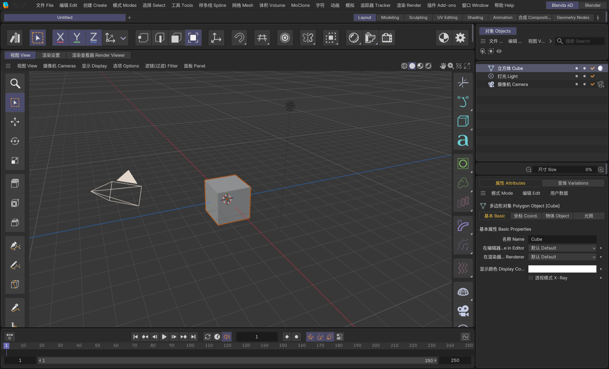

# Blenda 4D

[English](README.md) | **简体中文**

> **这是 [recon007jf/Blenda4D](https://github.com/recon007jf/Blenda4D) 的社区 fork**：包含一个 bug 修复版本
> （**0.1.28**）和 **Windows + macOS 一键安装包**。其余内容均为原项目，同为 GPL-3.0 协议。详见
> [本 fork 的更新](#本-fork-的更新0127)。

Blenda 4D 是一个免费开源的 Blender 插件，为 Blender 带来动态设计（Motion Design）的布局与工作流。

Blenda 4D 用它自己的布局替换 Blender 的编辑器布局：命令栏、工具列、**对象管理器（Object Manager）**、
始终跟随选中项的**属性管理器（Attribute Manager）**、**材质管理器**、**资产浏览器**、时间线和可保存的布局。
所有界面都用 Blender 原生按钮、输入框和菜单绘制；右上角有一个 **Blenda 4D | Blender** 开关，随时可以切回
标准 Blender，也可以再切回来。

它是纯 Python 插件：不需要修改版 Blender，无需编译。凡能运行 Blender 5.2 LTS 及以上版本的平台
（Mac、Windows、Linux）都能使用。

## 本 fork 的更新（0.1.28）

- **双语界面，跟随 Blender 的语言设置。** 使用 Blender 的简体中文（双语）时，Blenda 4D 自己的界面——
  菜单、标签、管理器、工具、按钮和提示——现在全部显示 中文 English，与 Blender 自带字典同一风格。
  约 1,550 条字符串译于 `blenda4d/translations.py`；Blender 字典已覆盖的词条仍由它显示，其他语言不受影响。
- **一键安装包现在可以选择安装到哪些 Blender。** 找到多个 Blender 5.2+ 时，输入编号（空格分隔）选择，
  或直接回车全部安装。脚本版本号改为从负载自动读取，不再硬编码。
- **修复：渲染设置现在能正确恢复视图着色**（自 0.1.27）。在命名的渲染设置之间切换时，所有
  `display.shading.*` 值（视图光照、颜色类型、背面剔除、X 光、阴影、腔体、轮廓、高光）会被静默跳过。
  `render_settings.py` 中一行解析修复，项目自带的 headless 测试验证（修复前 `FAIL 1`，修复后 `ALL PASS`）。
- **Windows + macOS 一键安装包**（见 [Releases 页面](https://github.com/luoboruodai/Blenda4D/releases) 的
  `Blenda4D-0.1.28-OneClick-WinMac.zip`）：通过 Blender 官方扩展安装接口完成安装并启用，按版本逐个
  报告结果。附卸载程序。全程无需手动操作，不写入 Blender 用户目录以外的任何位置。
- **测试脚本修复**：让项目自带检查在 Blender 5.3 上跑完全程（`tools/tests/`）。

已在 macOS 上用 Blender 5.2.2 LTS 与 5.3.0 Alpha 验证：双语界面经真实截图逐项核对、安装包的单选/多选/
全装三条路径、完整 安装 → 卸载 → 重装 流程、项目 10 个 headless 测试套件（597 项检查）、真实界面冒烟
测试（布局开/关还原）。Windows 安装脚本已通过静态检查，但尚未在真实 Windows 机器上运行——欢迎反馈。

## 安装

### 懒人方式：一键安装包（Windows + macOS）

1. 安装 [Blender 5.2 LTS](https://www.blender.org/download/) 或更高版本。
2. 从 [最新 Release](https://github.com/luoboruodai/Blenda4D/releases/latest) 下载
   **`Blenda4D-0.1.28-OneClick-WinMac.zip`** 并解压。
3. macOS 双击 **`Install Blenda4D (Mac).command`**（首次如被拦截：右键 → 打开）；
   Windows 双击 **`Install Blenda4D (Windows).bat`**。
4. 重启 Blender，即自动进入 Blenda 4D 布局。右上角 **Blenda 4D | Blender** 开关可随时切换。

需要卸载时，双击对应的 **Uninstall** 文件即可。你自己的布局、文件和其他插件不受影响。

### 通过 Blender 扩展列表安装（自动更新，上游构建）

1. 在 Blender 中：**编辑 > 偏好设置 > 获取扩展**，右上角 **仓库** 菜单，**+ > 添加远程仓库**，
   URL 填 `https://blenda4d.com/extensions/index.json`，勾选 **启动时检查更新**。
2. 在获取扩展中搜索 **Blenda 4D**，点击 **安装**。

### 从文件安装（无自动更新）

从 [最新 Release](https://github.com/luoboruodai/Blenda4D/releases/latest) 下载 `blenda4d-…zip`，
然后在 Blender 中：**编辑 > 偏好设置 > 插件 > 从磁盘安装**。

也可以直接运行源码：把 `blenda4d/` 文件夹链接或复制到 Blender 的扩展或插件目录。

## 0.1 版本功能一览

- **布局**：命令栏、模式、带彩色图标的工具列与创建列、视口标签与菜单、四视图（展开按钮可把视图拆成
  透视、顶、右、前四个视图再合回）、时间线走带控制、可保存的布局。
- **对象管理器**：交替行场景树；选择、重命名、拖拽重新指定父级；可见性与启用开关；滚动到活动对象；
  独奏；大小滑杆。
- **属性管理器**：跟随当前选中项的标签页。
- **参数化对象**：17 种保持可编辑的基础几何体。
- **样条**：12 种参数化样条形状（圆、矩形、圆弧、星形、螺旋、齿轮、轮廓等），以及 Blender 原生曲线的
  属性页。
- **生成器**：挤出、车削、扫描、放样、细分曲面、对称、布尔、连接、实例、阵列、重网格、减面、融球，
  由子对象实时构建。
- **变形器**：弯曲、扭曲、锥化、膨胀、剪切、晶格、缩裹、平滑、置换、波浪，挂在被修改对象之下。
- **灯光**：点光、聚光、对准聚光、面光、物理面光、IES 光域网、平行光与太阳光，含常规、细节、阴影页。
- **天空**：一个 Sky 对象承载 HDRI 或大气天空，以及地面。
- **资产浏览器**：自己的文件夹；从桌面拖入文件即变成带预览的资产；把资产拖进场景。
- **渲染设置**：可命名、可切换的多套设置，逐段管理，含帧范围模式。
- **材质管理器**：色板式的材质列表，带应用、拾取与清理工具。
- **材质标签**：在对象管理器中点击材质色板打开标签页：平铺、偏移、长度、投影，以及打散贴图重复的
  **无缝** 功能。即使共享材质，每个对象也保留自己的数值。
- **顶栏**：轴向、吸附、工作平面、软选择、对称、独奏与渲染按钮，全部接通 Blender 原生功能。
- **插件**：其他插件的 Add/Object 菜单项、侧边栏面板，以及 Blender 属性窗口。
- **键位**：可在 偏好设置 > 键位 中选择的 “Blenda 4D” 键位方案。

## 推荐插件

以下插件都不是必需的，但推荐用来增强体验。它们都是独立产品、各自有许可，本仓库不包含它们的任何内容。

- [Poly Haven](https://extensions.blender.org/add-ons/polyhaven-assets/)：资产浏览器里的免费 HDRI、贴图与模型。
- [Quixel Megascans](https://www.fab.com/)：扫描材质与物体。
- [Quad Remesher](https://exoside.com/quadremesher/)：任意网格生成干净四边面拓扑。
- [Sand3D](https://sand3d.ai/)：AI 生成 3D 模型。

## 参与贡献

先读 [AGENTS.md](AGENTS.md)：规则、插件结构、测试方法和已审定的界面样貌。它同时是 AI 编程助手的任务书；
`CLAUDE.md`、`.cursor/rules` 与 `.github/copilot-instructions.md` 都指向它，Claude Code、Cursor 和
GitHub Copilot 会自动读取。

本 fork 的安装器在 `installer/`；用 `tools/build_oneclick.sh /path/to/Blender` 可从源码重新构建一键
安装包（zip 产物在 `dist/`，不入库）。

## 许可证

GNU General Public License v3.0 或更新版本，见 [LICENSE](LICENSE)，与 Blender 相同。

Blenda 4D 是独立项目，与 Blender 基金会或任何软件公司均无隶属、背书或赞助关系。Blender 是 Blender
基金会的商标。所有其他商标归其各自所有者所有。
